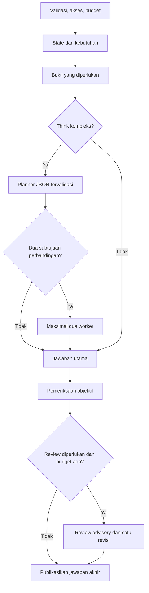

# Arsitektur B, migrasi, dan batas implementasi

Pembaruan 25 Oktober 2026: mekanisme routing dan kontrak bukti telah diperbaiki ke v2. Lihat `benchmark-routing-analysis.md`, `routing-policy-guide.md`, dan `routing-validation.md` untuk keadaan terbaru. Uraian bertanggal 24 Oktober di bawah dipertahankan sebagai riwayat; tabel kemampuan/status pekerjaan lama bukan hasil audit terbaru. Screening 96 sel telah selesai tetapi belum mempromosikan kandidat produksi.

Tanggal: 24 Oktober 2026. Masukan: ZIP `aet-aiv3.zip`, HEAD `0147f5b9b3ab0073bfce05ca79a38f2cc6a04563`. Tidak ditemukan AGENTS.md. Perubahan dari ZIP yang sudah ada dipertahankan; source tidak di-reset ke Git. Laporan `docs/*` lama yang disebut README masukan tidak disertakan dalam ZIP. Identitas, persona, CMS, autentikasi, schema/database Prisma dan upload tetap dipertahankan.

## Kontrak API

```json
{
  "mode": "coding",
  "responseMode": "normal",
  "messages": [{"id":"u1","role":"user","content":"Perbaiki fungsi ini"}],
  "frontierAccessToken": "opsional"
}
```

`mode` tetap persona `daily|report|coding`. `responseMode=fast|normal|think`, default Normal jika field tidak ada; nilai lain ditolak. Klien lama boleh mengirim `model` berupa string tetapi server mengabaikannya, termasuk model lama/Frontier. Field non-string ditolak. Tidak ada jalur pemilihan model publik. Server membedakan mode pengguna, persona, `requestedModel`, `reportedModel`, asal respons aplikasi/gateway, serta model setiap percobaan pada telemetry. Alias model belum ada; identitas gateway yang berbeda ditolak sebelum dapat menjadi jawaban final. Identitas yang tidak dilaporkan tetap `unreported`.

Batas input tetap eksplisit: 1–2000 pesan, tiap content ≤40.000 karakter, jumlah teks/ekstraksi ≤200.000 karakter, body ≤8 MiB. UI tidak lagi memangkas request ke 200 pesan; batas ini melindungi server tanpa menghilangkan riwayat diam-diam. Pesan assistant gagal, dibatalkan, atau streaming tidak menjadi konteks lengkap.

## Modul dan alur

| Tanggung jawab | File |
| --- | --- |
| Validasi request, penghubung SSE dan lifecycle | `app/api/chat/route.ts`, `lib/ai/context.ts` |
| Kebijakan tiga mode | `lib/ai/mode-policy.ts` |
| Reservasi budget seluruh peran | `lib/ai/budget.ts` |
| Gateway, akses per percobaan, retry dan semaphore | `lib/ai/provider.ts` |
| Jeda model, billing/quota bersama per key/gateway | `lib/ai/provider-health.ts` |
| Katalog 12 ID dan promosi berbasis bukti | `lib/ai-models.ts`, `model-router.ts`, `routing-policy.ts` |
| State dari branch valid dan context packet | `conversation-state.ts`, `context-packet.ts`, `task-analysis.ts` |
| Orkestrasi planner/worker/review/revisi | `lib/ai/orchestration.ts` |
| Schema hasil JSON dan pemeriksaan objektif sempit | `structured-output.ts`, `verification.ts` |
| Tools dan sumber | `tools.ts`, `knowledge.ts`, `evidence.ts` |
| Riwayat lokal, ticket request dan parser SSE | `lib/conversations.ts`, `request-lifecycle.ts`, `chat-stream.ts` |
| UI mode, status nyata dan akses AET | `components/ChatInterface.tsx` |



Respons deterministik/aplikasi dan klarifikasi acuan ambigu dapat melewati LLM. Fast selalu melakukan pemeriksaan programatis sesudah generasi. Normal memilih review untuk kompleksitas, kebutuhan referensi/angka, atau kegagalan tools. Think menambah planner hanya untuk tugas kompleks; dua worker hanya dipakai jika analisis kebutuhan menemukan perbandingan dan rencana berisi tepat dua subtujuan independen. Tidak ada kewajiban memakai model berbeda. Tidak ada classifier/peringkas LLM tambahan pada policy awal; jika ditambahkan, perannya sudah berada dalam budget yang sama.

Planner/worker/verifier mengembalikan JSON, diparse terhadap schema, batas ukuran, ID bukti dan allowlist. JSON tersebut bukan parameter structured-output native. Rencana tidak dapat memanggil shell atau mengeksekusi teks model. Hasil worker berisi kesimpulan, ID bukti, asumsi dan masalah yang belum selesai. Hasil model tetap data tidak tepercaya. Perbedaan pendapat diperiksa terhadap sumber dalam review, bukan voting. Review model tidak menjadi bukti kebenaran.

## Budget dan pembatalan

| Mode | Percobaan LLM | Tool logis | Revisi | Reservasi input total | Output total | Target packet input | Deadline | Konkurensi/request |
| --- | ---: | ---: | ---: | ---: | ---: | ---: | ---: | ---: |
| Fast | 2 | 2 | 0 | 48.000 | 4.096 | 24.000 | 30 s | 1 |
| Normal | 4 | 4 | 1 | 120.000 | 10.240 | 32.000 | 45 s | 1 |
| Think | 6 | 6 | 1 | 200.000 | 14.336 | 40.000 | 55 s | 2 |

Input adalah estimasi konservatif byte UTF-8 plus framing, bukan jumlah token terukur. Penyusunan packet menyisihkan ruang instruksi tahap. Peran tambahan menghitung seluruh pesan, termasuk system, state, bukti, worker dan draft. Generasi meminta batas output keluarga yang sudah dipakai repo. Cadangan jawaban akhir disisihkan sebelum planner/worker. Penggunaan aktual dan biaya berbasis usage dicatat hanya jika tersedia; tagihan provider aktual selalu `null` karena aplikasi tidak membaca billing provider.

Semua percobaan, termasuk retry gagal dan hasil JSON tidak valid, menghabiskan budget yang sama. Reservasi tidak dibebaskan saat kegagalan/usage hilang karena provider mungkin sudah memprosesnya. Global semaphore default 4 dan limiter default 120 panggilan/menit berlaku bagi semua peran. Satu tool logis dapat membutuhkan beberapa HTTP, misalnya geocoding dan forecast; hitungan tool berbeda dari jumlah HTTP internal.

Deadline induk membatalkan fetch dan pembaca stream. Planner dibatasi hingga 8 detik, worker hingga 12 detik, verifier hingga 8 detik dan tetap berada di bawah deadline induk; tahap tambahan dapat dilewati. UI timeout 65 detik dan route `maxDuration=60` tidak mengubah batas hosting sebenarnya. Stop, perpindahan percakapan/persona, penghapusan, cleanup, pembacaan stream dan ticket lama memakai AbortSignal/lifecycle yang sama. Edit/retry hanya diaktifkan setelah request sebelumnya selesai atau dihentikan, kemudian state dibangun ulang dari branch baru.

Output model dibuffer sebelum dipublikasikan pada semua mode. Status SSE melaporkan tahap nyata; draft dan private reasoning tidak dikirim. Buffered publication menambah waktu menuju token jawaban pertama dibanding streaming draft langsung; ini trade-off yang harus diukur pada provider nyata. SSE menyediakan `status`, `sources`, `meta`, `delta`, `done`, `cancelled`, `error`, serta heartbeat komentar. Validasi sebelum stream menghasilkan HTTP 4xx/5xx; kegagalan setelah stream dimulai berupa event error/cancelled pada HTTP 200, tanpa done. Klien lama tanpa Accept SSE tetap mendapat teks; stream teks gagal ditutup sebagai error, bukan sukses.

## Konteks dan migrasi

State schema 1 diturunkan deterministik dari pesan yang masih valid: tujuan aktif, subtopik, batasan, koreksi, nilai yang digantikan, keputusan, selesai/pending, rujukan lampiran, dugaan model, konflik dan unknown. Setiap entri memuat message ID, revisi, dan provenance. Hash `dual-fnv32` adalah detektor perubahan, bukan tanda tangan atau batas keamanan. Pertanyaan tentang nilai sekarang tidak dianggap sebagai koreksi nilai tersebut.

State klien tidak dipercaya atau di-merge. Server menghitung ulang dari pesan request; loader dan persister riwayat lokal juga menghitung ulang cache state. Edit, retry, branch dan penghapusan tidak menyisakan fakta dari pesan yang dihapus. Client-supplied user history tetap dapat dipalsukan oleh pemilik klien; state bukan catatan fakta terautentikasi.

Packet menggabungkan instruksi aplikasi, data state/bukti pada pesan user yang diberi batas tidak tepercaya, tugas terbaru, pesan yang terkait melalui rujukan/kata kunci, serta percakapan terbaru yang muat. Dokumen di-resolve sebelum budget. Maksimal empat gambar terbaru dipertimbangkan dan gambar yang tidak disertakan diberi pemberitahuan. Konteks fisik model tidak diartikan sebagai keharusan mengirim seluruh history.

Acuan “yang kedua” dihubungkan ke daftar terakhir. Jika pesan terakhir memiliki dua daftar yang masing-masing bernomor 2, aplikasi meminta satu klarifikasi. Ekstraksi state dan relevansi bersifat heuristik; belum terbukti sempurna untuk semua bahasa, pergantian topik, koreksi implisit atau acuan ambigu yang kompleks. Kutipan sumber tetap diperlukan. Jangan menafsirkan cache ini sebagai memori semantik sempurna atau sinkronisasi lintas perangkat.

Key penyimpanan `aet_ai_conversations_v2_<persona>` dipertahankan. Migrasi aditif: field responseMode hilang → Normal; modelId lama disimpan untuk sejarah dan tidak lagi dipakai memilih model; state lama diabaikan dan dihitung ulang. Empty v2 store tetap tombstone; data legacy yang dihapus tidak diimpor kembali. Biner lampiran tetap tidak disimpan. Tidak ada migrasi database server.

## Routing dan kemampuan

Default model-promotion policy `off` mempertahankan baseline. `shadow` hanya rekomendasi; `adaptive` membutuhkan bukti live terbaru, case set sebanding dengan baseline, review manusia, streaming dan biaya terukur sesuai loader repo. Tidak ada skor baru yang dikarang dan hasil mock tidak boleh mempromosikan model. Deteksi kebutuhan memakai tujuan/batasan/riwayat relevan serta persona, bukan hanya keyword pesan terakhir. Classifier LLM tidak diperlukan pada policy awal konservatif.

| ID | Streaming historis | Gambar historis | Native tools / reasoning parameter | Status pekerjaan ini |
| --- | --- | --- | --- | --- |
| gpt-4o-mini | tercatat lulus | tercatat uji dasar | unknown / unknown | baseline, belum diuji live ulang |
| gpt-4.1-mini | tercatat lulus | unknown | unknown / unknown | kandidat, belum dikalibrasi |
| gpt-5-mini | tercatat lulus | unknown | unknown / unknown | kandidat, belum dikalibrasi |
| gpt-5.4-mini | tercatat lulus | unknown | unknown / unknown | kandidat, belum dikalibrasi |
| gpt-5.4 | tercatat lulus | unknown | unknown / unknown | Frontier, belum dikalibrasi |
| claude-haiku-4-5 | tercatat lulus | unknown | unknown / unknown | kandidat, belum dikalibrasi |
| claude-sonnet-5 | tercatat lulus | unknown | unknown / unknown | Frontier, belum dikalibrasi |
| claude-opus-5 | tercatat lulus | unknown | unknown / unknown | Frontier, belum dikalibrasi |
| gemini/gemini-3.5-flash | tercatat lulus | unknown | unknown / unknown | kandidat, belum dikalibrasi |
| gemini/gemini-3.1-pro-preview | tercatat lulus | unknown | unknown / unknown | Frontier, belum dikalibrasi |
| deepseek-v4-flash | tercatat lulus | unknown | unknown / unknown | kandidat, belum dikalibrasi |
| deepseek-v4-pro | tercatat lulus | unknown | unknown / unknown | Frontier, belum dikalibrasi |

“Tercatat” berasal dari source katalog bertanggal 22 Oktober 2026; laporan live aslinya tidak ada dalam ZIP ini. Kapasitas konteks di katalog juga historis, tidak diuji ulang. Pemeriksaan terbaru yang blocked tidak menghapus catatan sebelumnya. Harga tidak dikenal sampai operator memasukkan tarif gateway resmi yang benar. Metadata ID tidak membuktikan kualitas, native tools, parameter reasoning, modalitas tambahan, atau kesetaraan model gateway dengan produk resmi.

Setiap peran/retry mengulang pemeriksaan token Frontier, ENABLE_FRONTIER, ketersediaan, streaming dan limiter. Public payload tidak dapat mengaktifkan model Frontier. Retry dibatasi satu kali pada model yang sama, hanya kegagalan transport/HTTP 5xx sebelum publikasi dan jika budget cukup. Tidak ada rotasi lintas model untuk billing/quota atau fallback tidak terkalibrasi. Shared cooldown key/gateway menghormati Retry-After pada rate limit dan menahan auth/billing/permission; dua HTTP 5xx memberi jeda model 30 detik. State kesehatan per proses tidak menggantikan observabilitas gateway.

## Bukti dan pemeriksaan

Tool lama tetap tersedia: web HTTPS dengan SSRF/DNS pinning, pencarian, cuaca, kurs, satuan, statistik, warna, format email dan password kriptografis. Ditambahkan aritmetika grammar deterministik tanpa eval. Pencarian kontekstual membaca tujuan aktif untuk followup. Planner hanya boleh menambah pencarian/web jika kebutuhan fakta terbaru memang terdeteksi dan pengguna tidak melarang. Verifier dapat meminta satu pencarian lanjutan yang tervalidasi, tetap di bawah budget tool dan deadline.

Sumber memuat ID, rujukan/URL, waktu akses, cuplikan sukses, cakupan, dan status. Search snippet berbeda dari page read. Pesan kegagalan upstream tidak dipublikasikan sebagai cuplikan sumber. Dokumen, web, hasil worker dan state tidak dijadikan instruksi sistem tepercaya. Proteksi lampiran, SSRF dan URL Markdown sebelumnya dipertahankan.

Pemeriksaan programatis mencakup nonempty, JSON-only bila diminta, provenance URL/DOI dan klaim menjalankan kode tanpa tool. Keanggotaan URL hanya menunjukkan asal sumber, bukan dukungan semantik klaim. Tautan/DOI yang sudah diberikan pengguna boleh dipertahankan tanpa klaim bahwa sumbernya sudah diverifikasi. Verifier membantu menguji tujuan, bahasa, angka, satuan, asumsi dan bukti tetapi bersifat advisory. Revisi maksimal satu; sesudah revisi hanya pemeriksaan programatis yang diulang, bukan loop LLM baru. Referensi tanpa bukti disamarkan pada jawaban dan batas pemeriksaan dinyatakan. Ini bukan jaminan bebas halusinasi.

Input gambar memakai reservasi estimasi yang belum dikalibrasi pada gateway, sementara input teks memakai estimasi byte. Dengan AET_MAX_REQUEST_USD, gambar ditolak (`VISION_PRICING_UNKNOWN`) sampai tarif/perhitungan token gambarnya sah. Tanpa batas USD, usage vision yang hilang tetap unknown dan operator harus memakai cap provider. Tidak ada klaim spending cap provider dari environment aplikasi.
