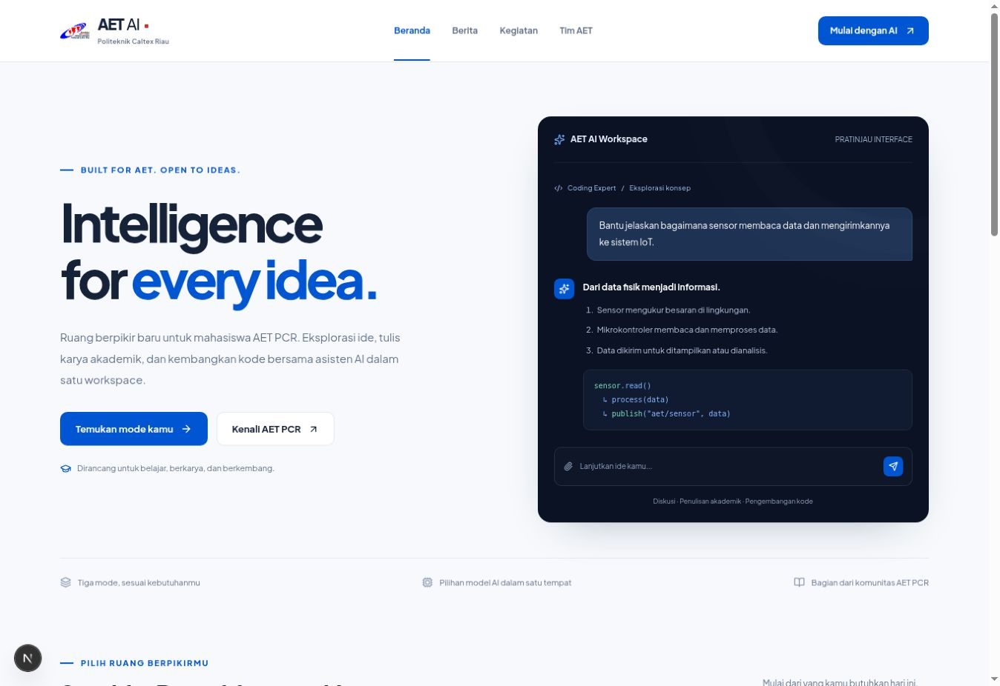
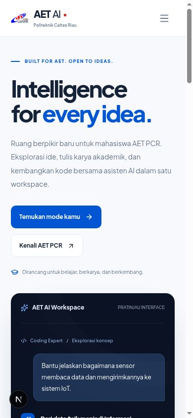
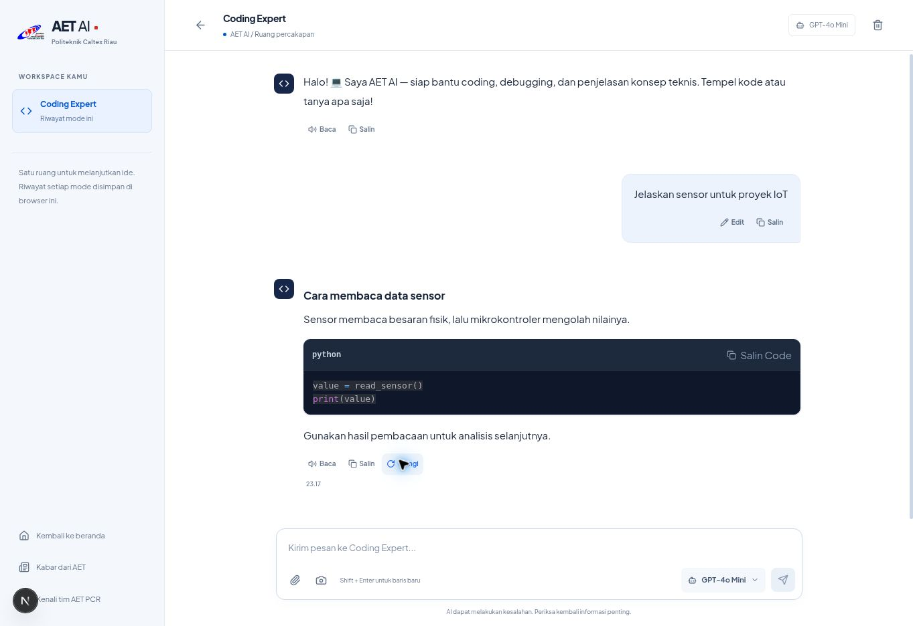
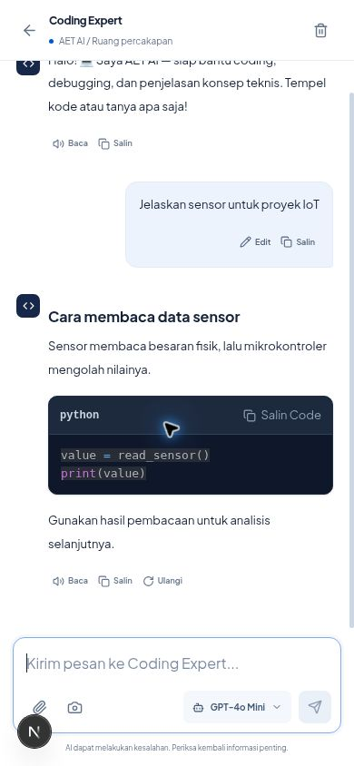
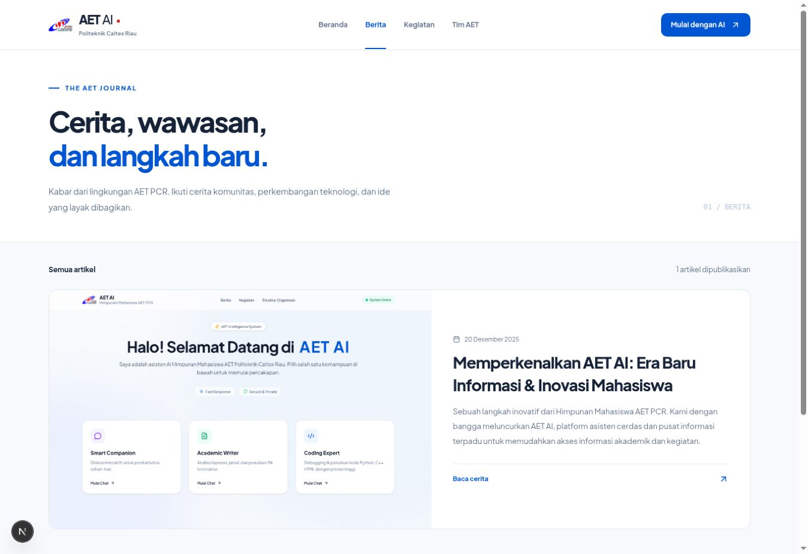
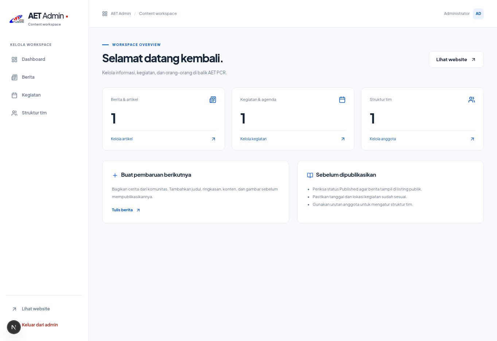
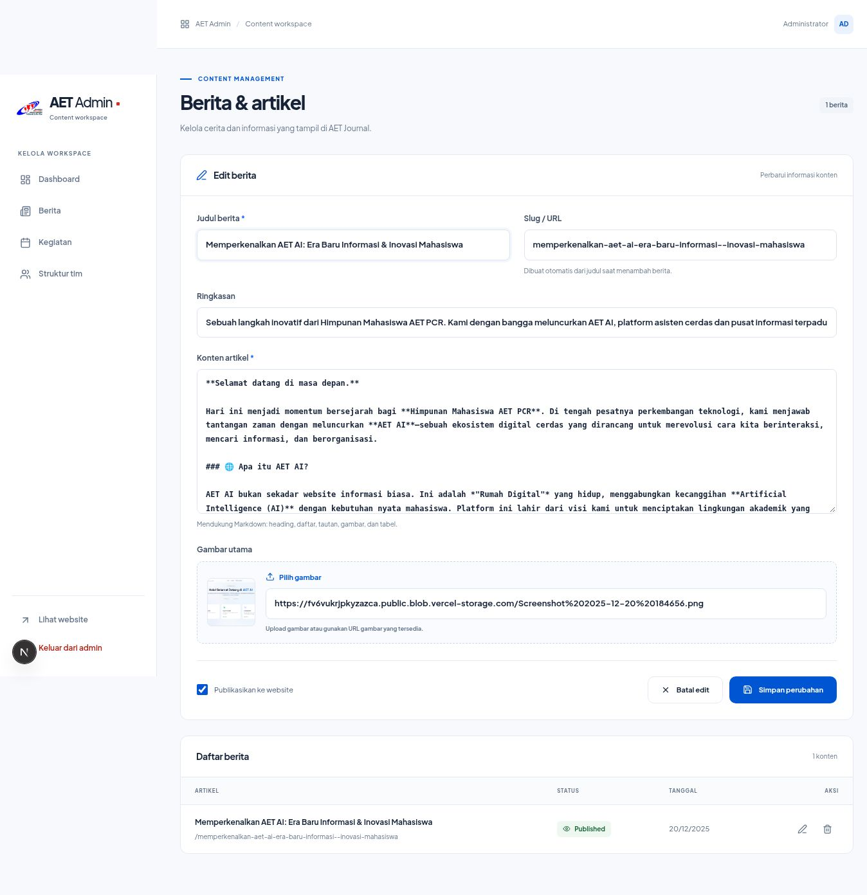

## Catatan patch 2.1.1

Screenshot yang ada tetap merupakan arsip desain sebelumnya. Halaman awal desktop telah diamati, tetapi kelanjutan QA final setelah preview restart ditolak kebijakan URL browser. Tidak ada screenshot baru yang diklaim membuktikan keseluruhan patch. Status pengujian yang dapat dipertanggungjawabkan ada di UI_VERIFICATION_2_1_1.md.

---

> **ARSIP BASELINE REDESIGN.** Dokumen ini menjelaskan tahap sebelum 2.1. Untuk hasil terkini baca FINAL_IMPLEMENTATION_REPORT.md dan REGRESSION_TEST_REPORT.md.

# Screenshot implementasi AET AI

Screenshot diambil dari aplikasi yang berjalan. Chat menggunakan gateway simulasi untuk pengujian. Dashboard/editor memakai komponen aktual dengan salinan database.

## Landing desktop

## Landing mobile

## Chat desktop

## Chat mobile

## Berita

## Dashboard admin

## Editor admin

